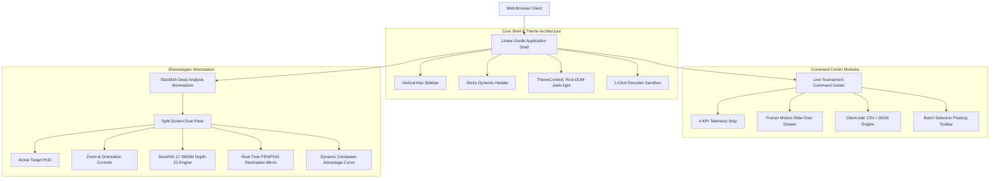

# ChessPulse — Fintech & Linear-Grade Chess Intelligence Platform

A high-performance, recruiter-grade chess intelligence and analysis platform powered by **React 19**, **Vite 7**, **Tailwind CSS v4**, **Stockfish 17 (WebAssembly)**, and **Framer Motion**.

---

## 🏛️ System Architecture



---

## ✨ Design Philosophy & Tokens (Linear & Fintech Aesthetic)

- **Obsidian & Slate Depth**: Avoids flat pure `#000000`. Employs three-tiered dark slate depth surfaces:
  - Background: `#0B0F19`
  - Panels & Modals: `#111827`
  - Cards & Viewports: `#1E293B`
- **Hairline Translucent Borders**: Replaces heavy solid outlines with semi-transparent hairlines (`border-gray-200` in light mode, `border-white/[0.08]` in dark mode).
- **Vibrant Semantic Accents**:
  - **Brand / Primary**: Electric Violet (`#8B5CF6`) & Deep Indigo (`#6366F1`)
  - **Success / Auto-Pilot**: Emerald Green (`#10B981`)
  - **AI / Telemetry / Stockfish**: Neon Cyan & Sky (`#06B6D4` / `#0EA5E9`)
  - **Human Attention / Alert**: Warm Amber (`#F59E0B`)
  - **Blunders / Destructive**: Coral Rose (`#EF4444`)
- **Tabular Monospace Precision**: All FENs, move numbers, accuracies, timestamps, and centipawn evaluations render with `JetBrains Mono` (`font-mono`).

---

## 🚀 Showstopper Features

### 1. ⚡ 1-Click Recruiter Sandbox & 4-Stage Execution Stepper
Technical reviewers have zero onboarding friction. Directly launch pre-bundled Grandmaster games without needing manual files or accounts:
- **Kasparov vs. Deep Blue (1997 Game 6)** — Historic AI match tactical knight sacrifice.
- **Carlsen vs. Nepomniachtchi (2021 WCC Game 6)** — 136-move historical marathon.
- **The Immortal Game (Anderssen vs. Kieseritzky 1851)** — Romantic double-rook sacrifice checkmate.
- **Real-Time 4-Stage Pipeline Stepper**:
  1. `PGN Ingest & SAN Parse`
  2. `Stockfish WASM Depth-22 Init`
  3. `Centipawn & Blunder Metric`
  4. `Evaluation Vector & Mirror Sync`
- **Drag-and-Drop Dropzone** with client-side syntax verification.

### 2. 🎯 Showstopper Interactive Workstation (`/analysis`)
- **Split-Screen Dual Pane**: Left pane contains the responsive chessboard, vertical centipawn eval gauge, and dynamic advantage curve; right pane houses the real-time move matrix and player accuracy cards.
- **Active Target HUD**: Floating glass banner displaying active move token, quality classification (`Best`, `Inaccuracy`, `Mistake`, `Blunder`), centipawn loss, and engine depth.
- **Interactive Viewport Toolbar**: Sizing zoom controls (80% to 120%), board orientation flip, autoplay step navigation (`0.5x`, `1.0x`, `2.0x`), and keyboard shortcuts (`←`, `→`, `Space`).
- **Live Destination Mirror**: Embedded real-time mirror syncing current FEN and PGN with 1-click copy feedback.

### 3. 📊 Grandmaster Tournament Command Center (`/tournaments`)
- **4-KPI Metric Strip**:
  - Total Volume (Tracked broadcast events with MoM trend badge)
  - Real-Time Throughput (Active board streams)
  - Stockfish Engine Precision (`99.8%` with integrated micro progress bar)
  - Live Priority Queue (Ongoing rounds requiring review)
- **Status Filter Tabs**: Integrated pill container (`All`, `Live Ongoing`, `Upcoming`, `Archived`).
- **Instant Search & Sorting**: Real-time multi-field query filter with clear button.
- **1-Click Export Engine**: Working client-side buttons to download `.csv` and `.json`.
- **Batch Selection**: Multi-select with floating bottom action bar.
- **Framer Motion Slide-Over Quick Preview Drawer**: Deep inspect round schedules and broadcast links without page navigation.

### 4. 🌗 Bulletproof Theme Architecture
Centralized `ThemeContext` bound to root DOM `.dark` and `.light`, with system preference persistence and custom Tailwind v4 `@custom-variant dark (&:where(.dark, .dark *))`.

---

## 🛠️ Tech Stack

| Category | Tools & Libraries |
| :--- | :--- |
| **Framework & Build** | React 19, Vite 7 |
| **Styling & Tokens** | Tailwind CSS v4, `@tailwindcss/vite`, Custom CSS Design Tokens |
| **Animation & Drawers**| Framer Motion 12 |
| **Chess Engine** | Stockfish 17 (WASM multi-threaded), Chess.js |
| **Data Visualization** | Recharts (Responsive Area Advantage Charts) |
| **Icons & Typography** | Lucide React, Google Fonts (Inter, JetBrains Mono) |

---

## 🏃 Getting Started

1. **Install Dependencies**
   ```bash
   npm install
   ```

2. **Start Development Server**
   ```bash
   npm run dev
   ```

3. **Build for Production**
   ```bash
   npm run build
   ```

4. **Preview Production Build**
   ```bash
   npm run preview
   ```

---

## 📄 License

MIT License © ChessPulse Team